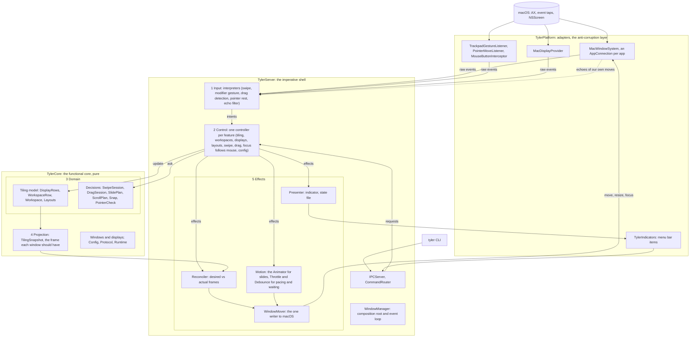
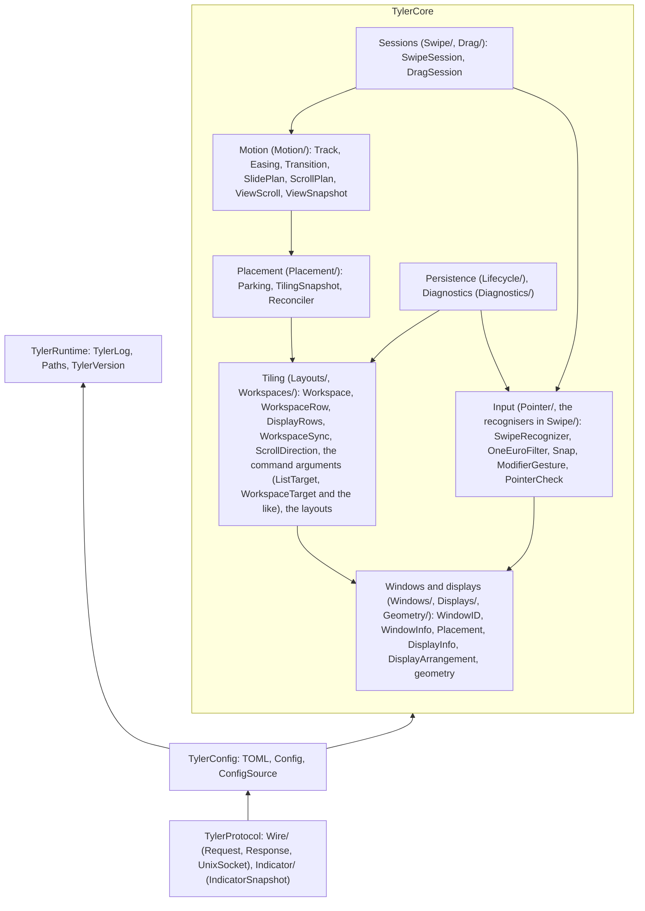

# Architecture

The structure tyler's code is moving towards, and the rules that keep it there. Read this before
a change that adds a type, a folder or a dependency between parts. The design principles in
`CLAUDE.md` are the short form; `design.md` records the individual decisions taken under them;
The end of this file says how far the code is from it.

## What tylerd is

tylerd is an event-driven control loop over windows it doesn't own. Inputs arrive from macOS
(window notifications, trackpad gestures and mouse events, display changes) and from commands. tylerd
decides what the windows should look like, asks macOS to make it so, and macOS answers with what
it really did: its own moves echo back as notifications, apps resize themselves, windows are
clamped at a display's edge.

So the patterns that fit are those of a controller loop, not of a UI that owns its view:

- **Functional core, imperative shell.** The model and every decision are pure values in
  TylerCore, unit tested without fakes. Side effects happen only at the edges: TylerServer runs
  them, TylerPlatform talks to macOS.
- **Input → intent → update → effects** (as in Elm or Redux). Every input becomes an intent in
  domain words; handling it updates the model and returns what should happen, which the shell
  carries out.
- **Desired state, reconciled** (as in React or a Kubernetes controller). The model is projected
  to the frame each window should have; a reconciler compares that with what macOS reports and
  moves only what differs. A missed event or a window an app moved heals on the next pass.
- **Domain-driven design, the strategic half.** One vocabulary (the words of `docs/manual.md`),
  bounded contexts with one-way dependencies, aggregates that keep invariants (a window is on at
  most one workspace), and TylerPlatform as the anti-corruption layer that turns AX's world into
  ours. Not the tactical half (repositories, factories, services): tyler is one process with one
  model, and they would add types without adding clarity.

Classic MVC fits only loosely. The model is the tiling domain, but the view is other apps'
windows, which tyler can only request changes to and which push back; the controller role is
split between the input layer and the controllers below.


## The layers



1. **Input.** Interpreters turn raw events into intents: `focus(window)`, `swap(a, b)`,
   `switchWorkspace(n)`, `windowAppeared(window)`, `displaysChanged`, `resize(window, to:)`. They
   are where a gesture is recognised, where AX moves plus a held button become a drag, and where
   tylerd's own moves coming back are filtered out, in one place. Recognisers that must run inside
   a listener for latency (the swipe, the modifier gesture) stay in TylerPlatform, but hand over
   intents, not half-read events.
2. **Control.** One controller per feature. It takes an intent or a request and the model
   (`inout`), asks the domain to decide, and returns the effects and, for a request, the
   `Response`. It holds no state of its own beyond the session in progress, which `Interaction`
   owns, and never calls the backend.
3. **Domain.** The tiling model and the decisions over it, pure. `DisplayRows` is the aggregate
   root: changes to rows, workspaces and layout states go through it, so its invariants hold.
4. **Projection.** The model, the connected displays and the gaps give the frame every window
   should have, in view or parked (`TilingSnapshot`). A slide or a swipe is a transition between
   two projections.
5. **Effects.** The shell carries effects out. The reconciler compares the projection with the
   registry's frames and moves only what differs (`Reconciler`); the `Animator` runs slides
   frame by frame, `Throttle` paces swipe steps and drag resizes, `Debounce` waits for the
   pointer to rest and the displays to settle; `Interaction` makes two motions at once impossible
   and `endInteraction` ends whichever runs, in one place; the `WindowMover` is the only code that
   writes to macOS; the indicator follows the model, redrawing only on a change, and the state
   file is written at a hand-over.

`WindowManager` composes the parts, runs the event loop and owns the model. It routes each input
to its interpreter and each intent or request to its controller, then runs the effects. It holds
no feature logic.

## Bounded contexts

The pure code falls into contexts with one-way dependencies. SwiftPM targets keep the coarse
ones apart, checked by the compiler: TylerCore (the domain: Windows and displays, Tiling,
Placement, Motion, Input, Sessions, Persistence, Diagnostics), TylerConfig above it, and
TylerProtocol above that (the wire, and what menu bar items are given). Beside them,
TylerRuntime holds what concerns tyler as a running program (its log, its files, its version);
TylerCore doesn't depend on it, so the compiler keeps the pure core from logging or touching
files. Inside TylerCore the contexts are folders, kept apart by SwiftLint rules.



The arrows point from a context to what it depends on, and never back:

- **Windows and displays** are the shared vocabulary every context builds on, and know nothing
  of them. `Placement` here is the struct (a window and the frame it should have), not the
  `Placement/` context.
- **Runtime** depends on nothing in tyler. Logging doesn't know about windows; a window's log
  name belongs to the window model. The domain doesn't know about logging: a controller or the
  shell logs what the domain decided.
- **Config** turns the file into domain values (`LayoutKind`, `ModifierKeys`, the workspace
  count), so it sits above the domain, at the edge. No domain type depends on `Config`: a layout
  takes `LayoutGaps`, and `Config` converts.
- **Tiling** is the core domain. It owns its vocabulary, including what commands talk about
  (`ListTarget`, `WorkspaceTarget`, `DisplayTarget`); the wire protocol uses that vocabulary, not
  the other way round. It doesn't know where a window is parked or how it moves.
- **Placement** turns the tiling model into frames on displays. **Motion** turns two placements
  into tracks over time. **Input** turns touches and clicks into travel and gestures.
  **Sessions** combine input and motion into a swipe's or a drag's decisions.
- **Config**, **Protocol**, **Persistence** and **Diagnostics** sit at the edge and map the
  domain to and from a file, bytes, a menu bar snapshot, a state file or a report.

TylerServer mirrors the layers: a folder per feature holds its controller (and interpreter, if
it has one) and the feature's input handling and pacing as `extension WindowManager`,
`Motion/` the timing types and the mover, `Model/` the model and the registry, `Manager/` the
manager itself, the controllers' shared types and the effect runner, `Input/` the window
event interpreter. `Ports/` holds the ports, the protocols in front of macOS that TylerPlatform implements.

TylerPlatform has a folder per port, named after it, with its real implementation `Mac<Port>`
and what only that implementation uses. Types are named after their responsibility; only the
lowest layer, whose responsibility is a technology, is named after it. The window system reads
top-down in layers:

```
WindowManager, controllers      the domain: windows, apps, workspaces, displays, layouts
        │  WindowSystem (the port)
MacWindowSystem                 all apps: which run, attaching and retrying, which window is in
        │                       which app, the focused window, the event stream
AppConnection (one per app)     one app: its windows and reading them, its notifications, its
        │                       step queue, moving, focusing and closing, whether it answers
AXBridge                        the typed Accessibility vocabulary tylerd speaks
        │
AXClient, WorkspaceClient       dumb one-to-one seams over the C Accessibility API and
                                NSWorkspace (MacAXClient, MacWorkspaceClient; faked in tests)
```

The window system holds `any AXClient`, on the path of every step of a slide: an exception to
keeping the hot paths free of existentials, since each call is a round trip to an app that
takes milliseconds.

## Rules

- A new feature is a controller in its own folder, with its decisions in TylerCore, not an
  `extension WindowManager`.
- A controller returns effects; it doesn't run them. Only the `WindowMover` writes to macOS.
- Code outside TylerPlatform and the executables doesn't import AppKit or ApplicationServices.
- A context only imports the contexts below it. A dependency that would point up means a type is
  in the wrong place: move it down, or convert at the edge.
- Every piece of mutable state has one owner (`CLAUDE.md`); the model's owner is
  `WindowManager`, a session's is `Interaction`.
- Only `WindowMover` calls the backend's moves and focus, and no controller reaches the manager,
  the mover or the backend: SwiftLint checks both.
- One type per file, named after it, with its tests at the mirrored path in `Tests/`
  (`CLAUDE.md`, Design principles): SwiftLint and `devtools/check-test-paths` check it.
- Each part is tested at the lowest layer that can catch its bugs: decisions as unit tests, the
  server as a whole on fakes, macOS itself on real windows (`testing-strategy.md`).
- Words come from `docs/manual.md`. Internal terms: a *listener* watches a stream of macOS input
  events and an *interceptor* can also hold events back or swallow them (both are built on what
  Apple calls an event tap, listen-only or active); an *intent* is what an input means, an
  *effect* is what a controller wants done, a *projection* is the frames the model asks for, a
  *plan* is a motion decided ahead, a *session* is a gesture in progress.

## Where the code stands

As of October 2026, after the layout refactoring, the WindowManager split and the restructuring
that followed (controllers and effects, the module split, the interpreter and the reconciler):

| Part | Today | Gap to the target |
|---|---|---|
| Domain and decisions | Pure: layouts own their state, `SwipeSession`, `DragSession`, `SlidePlan`, `ScrollPlan`, `Snap`, `PointerCheck`. Targets for the domain, Config, Protocol and Runtime; a folder per context inside TylerCore, with dependencies pointing one way | — |
| Projection | `TilingSnapshot` gives every window's frame at rest, which `Reconciler` compares with the registry | Windows of parked workspaces are re-parked only on a display change, not on every command (re-parking every drifted window on every command would cost a round trip per window an app
keeps a point off) |
| Effects | Controllers return `Effect`s, which the manager runs in one place; `Effect.reconcile` moves only what `Reconciler` finds off; `WindowMover` is the only caller of the backend's moves and focus | — (one clock and one motion runner were dropped; see `design.md`) |
| Input | Recognisers are pure; `WindowEventInterpreter` turns window events into intents and recognises tylerd's focus echoes; the pointer is watched through one `PointerWatch` | — |
| Control | A controller per feature (`LayoutController`, `SyncController`, `TilingController`, `WorkspaceController`, `DisplayController`, `ConfigController`, `FocusFollowsMouseController`, `SwipeController`, `DragController`), tested without a backend | — (each feature's input handling and pacing stay `extension WindowManager` in its folder; see `design.md`) |
